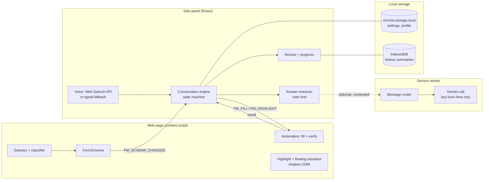

# FormMate — Every form. Every website. Just speak.

FormMate is a Chrome / Edge (Manifest V3) extension that detects an online form on the page you are using and fills it **by voice**. You speak in Tamil, English, Hindi, Telugu, Kannada, Malayalam, Bengali or Marathi; FormMate maps each answer to the real field on the page, fills it, verifies it, tracks progress and lets you review everything. **It never submits a form for you.**

## The problem

Government, college, job and bank forms are long, in English, and hard for people who are more comfortable speaking in their own language, are older, or have difficulty typing. Copy-paste tools only help people who already have clean data.

## What makes it different

- Works on the **real page**, not a PDF copy or a separate chatbot.
- Asks one question at a time in your language, understands spoken emails, phone numbers, dates and options.
- **Verifies** every fill (re-reads the field after a moment) and reports when a site rejects or resets a value.
- **Offline first**: all understanding is rule-based and works with no API key. Gemini is an optional extra.
- Privacy-first: no account, no FormMate server, minimal permissions.

## Features

Voice and text answers · automatic form detection · text, email, phone, number, date, textarea, dropdown, radio, checkbox and checkbox-group fields · multi-step forms · progress bar · review screen (completed / missing / uncertain / invalid / manual) · confirmation before filling · skip / repeat / back / pause / change an earlier answer · optional local profile · "save for later" · history (summary only) · Easy Mode, high contrast, large text, reduced motion · demo job-application site · unit tests.

## What FormMate will never do

Auto-submit · solve CAPTCHAs · fill password, one-time-code or card fields · upload files for you · invent data. Those fields are shown as "please do this yourself" notices.

## Architecture



Key decisions: the DOM layer stays in the content script (page elements never cross messaging; only plain `FormSchema` data does). The Gemini key and requests live only in the service worker. The extension UI is injected inside a shadow DOM and never modifies page elements.

## Install (load unpacked)

Requirements: Chrome or Edge 114+.

1. Open `chrome://extensions` (Edge: `edge://extensions`).
2. Turn on **Developer mode**.
3. Click **Load unpacked** and choose the `dist` folder of this project.
4. Pin FormMate to the toolbar.

To rebuild from source (Node 18+): `npm install`, then `npm run build`.

## Try the demo

```
npm run demo        # serves http://localhost:5173
```

Open http://localhost:5173 (the extension detects forms there with no extra permission), click the FormMate icon → **Start voice fill**. The demo is a 3-step job application with validation errors, a dynamic "Other" field, a dropdown, radios, checkboxes, a file input and a password field (the last two are left to you).

No microphone? Type your answers in the box under the question.

## Using it on other websites

By default FormMate reads a page only when you click its icon (`activeTab`). To get automatic "form detected" notices on every site, open **Settings → Privacy & permissions → Turn on…** and approve the browser's permission prompt. You can turn it off any time.

Local `file://` pages: enable **Allow access to file URLs** for FormMate on the extensions page.

## Optional AI (free)

1. Get a free key at https://aistudio.google.com.
2. Settings → Optional AI → turn on, paste the key, accept the consent toggle, **Test connection**.

AI is used only when the built-in rules cannot understand an answer (or you enable polishing), never for sensitive/manual fields, and any rewrite or translation is confirmed by you first. Without a key everything still works.

## Privacy and permissions

| Permission | Why |
|---|---|
| `activeTab`, `scripting` | read the current page only after you click FormMate |
| `storage` | settings and optional profile, in your browser |
| `sidePanel` | the assistant panel |
| `generativelanguage.googleapis.com` | only if you enable Gemini |
| optional `http(s)://*/*` | only if you turn on automatic detection |

No analytics, no account, no remote server. History stores site, title and progress only; answers are saved only if you press **Save for later**. Everything can be deleted in Settings.

## Tests

```
npm test            # 59 unit tests (vitest + jsdom)
npm run typecheck
```

Covered: form detection and classification, fill + verify for every field type (including a site that resets values), spoken email/phone/date/option extraction, validation, storage and history, AI gating and output validation, and the conversation engine against the demo form (never submits, never fills password/file, confirmation, skip, pause, profile offers).

## Project structure

```
src/
  extension/      background/ content/ sidepanel/ popup/ settings/ permission/
  services/       form/ (detector, classifier, automation, validator)
                  ai/ (extractor, engine, Gemini) voice/ storage/ i18n.ts
  components/ui/  shared React components
  types/ utils/ tests/
demo/             local job-application site      scripts/  icons, demo server
public/           manifest.json, icons            dist/     built extension
```

## Known limitations

- **Languages:** All eight languages have full on-screen and dialogue translation (reviewed by machine translation, not yet by native speakers, so wording may need polish). Speech recognition and voices depend on what your browser and operating system support.
- Speech recognition in Chrome/Edge uses the browser's online service; typed answers always work.
- Detection runs in the top frame. Forms inside cross-origin iframes, canvas widgets, and heavily custom components (non-native dropdowns) may not be filled reliably.
- Sites that reset values after you fill them are reported as needing attention rather than silently skipped.
- Not yet tested in real browsers by the author on every site; behavior on third-party sites will vary.
